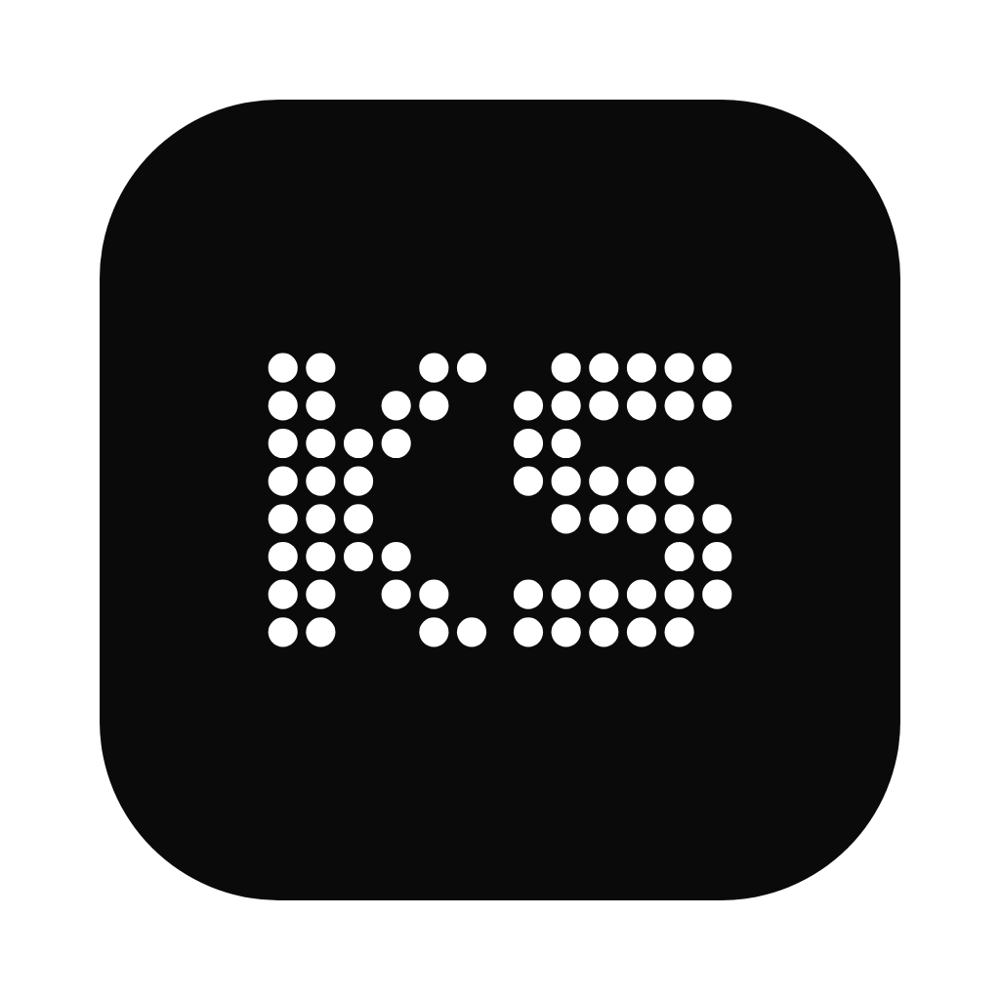

<p align="center"></p>

# KaDeep Release Gate (GitHub Action)

**Go / no-go for every pull request.** Engineering release confidence.

Two ways to use it:

- **Test your preview deploy, no account needed.** An AI QA engineer ([kadeep](https://github.com/kadeep-ai/kadeep-cli)) opens the URL in a real browser, tries the user journey you name and fails the check with the bugs it found, the console errors and the failed requests. Optional WCAG 2.2 AA audit.
- **Run your release policy.** With a [KaDeep Studios](https://kadeep.ai) project, [`releasegate`](https://www.npmjs.com/package/releasegate) runs the suites your `releasegate.yml` requires on web, mobile and desktop, and returns GO or NO-GO.

## Test a preview URL

```yaml
name: QA
on: deployment_status
jobs:
  kadeep:
    if: github.event.deployment_status.state == 'success'
    runs-on: ubuntu-latest
    steps:
      - uses: kadeep-ai/releasegate-action@v1
        with:
          url: ${{ github.event.deployment_status.environment_url }}
          goal: sign up with a new email and reach the dashboard
          a11y: true
          anthropic-api-key: ${{ secrets.ANTHROPIC_API_KEY }}
```

The job summary shows the verdict, each check and a bug table; bugs are annotated on the run, and screenshots plus `report.json` are uploaded as the `kadeep-report` artifact. No Anthropic key? Use `kadeep-token` with a KaDeep token (`npx kadeep try` or a free account at [kadeep.ai/start](https://kadeep.ai/start)).

## Run a release policy

```yaml
name: KaDeep Release Gate
on: [pull_request]
jobs:
  releasegate:
    runs-on: ubuntu-latest
    steps:
      - uses: actions/checkout@v4
      - uses: kadeep-ai/releasegate-action@v1
        with:
          ci-token: ${{ secrets.KADEEP_CI_TOKEN }}
```

`npx kadeep init` writes `releasegate.yml` (starting in `mode: shadow`, which reports but never blocks) and creates the CI token.

## Inputs

| Input | Mode | Description |
| --- | --- | --- |
| `url` | test | URL to test. Setting it switches to test mode. |
| `goal` | test | User journey to check. Empty: explore and hunt for bugs. |
| `viewport` | test | `desktop` (default) or `mobile`. |
| `a11y` | test | `true` adds a WCAG 2.2 AA audit; serious or critical violations fail the check. |
| `anthropic-api-key` | test | Anthropic key for the QA agent. |
| `kadeep-token` | test | Or run on KaDeep's plan. |
| `ci-token` | policy | The project's `KADEEP_CI_TOKEN`. |
| `policy` | policy | Policy file (default `releasegate.yml`). |
| `mode` | policy | Override: `enforce` or `shadow`. |
| `api` | both | KaDeep API URL. |
| `version` | both | npm range of kadeep / releasegate (default `^0.4`). |
| `working-directory` | both | Where to run. |

Outputs: `verdict` (`pass` / `fail` / `error`, or `go` / `no-go`) and `report` (the report directory).

## License

[Apache-2.0](LICENSE) © Kadeep Technologies. Source of the CLIs: [kadeep-ai/kadeep-cli](https://github.com/kadeep-ai/kadeep-cli).
